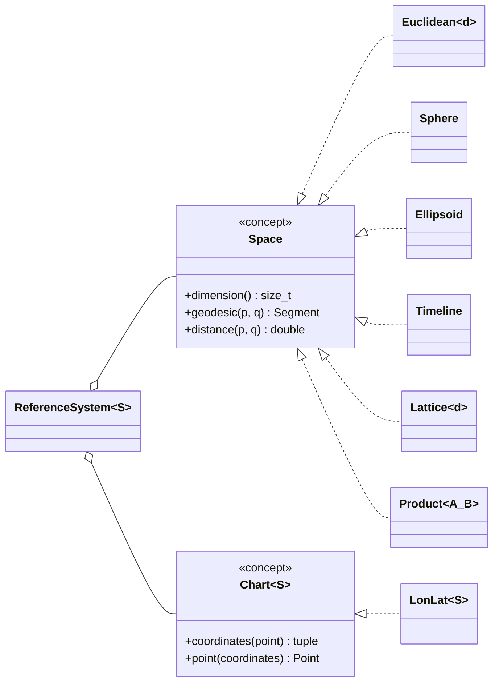
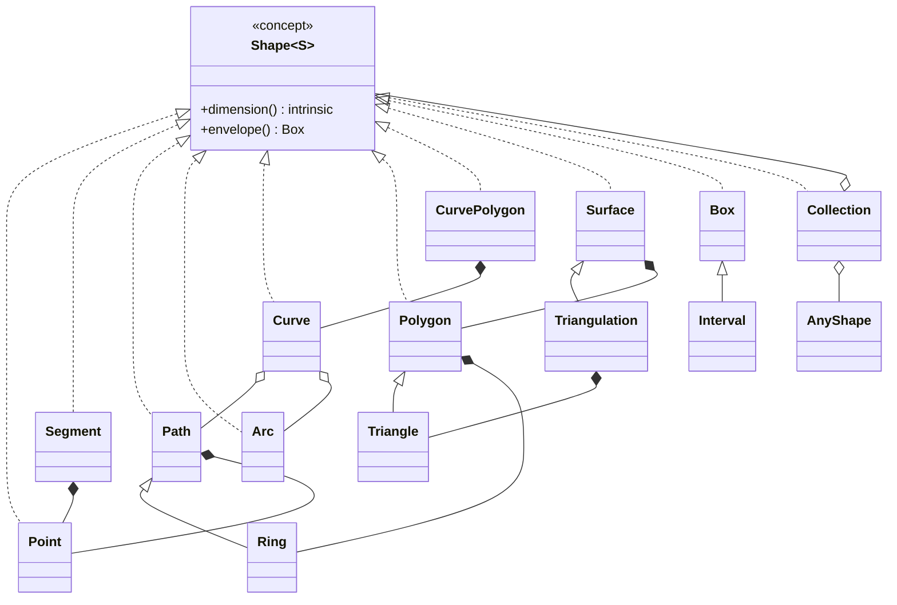
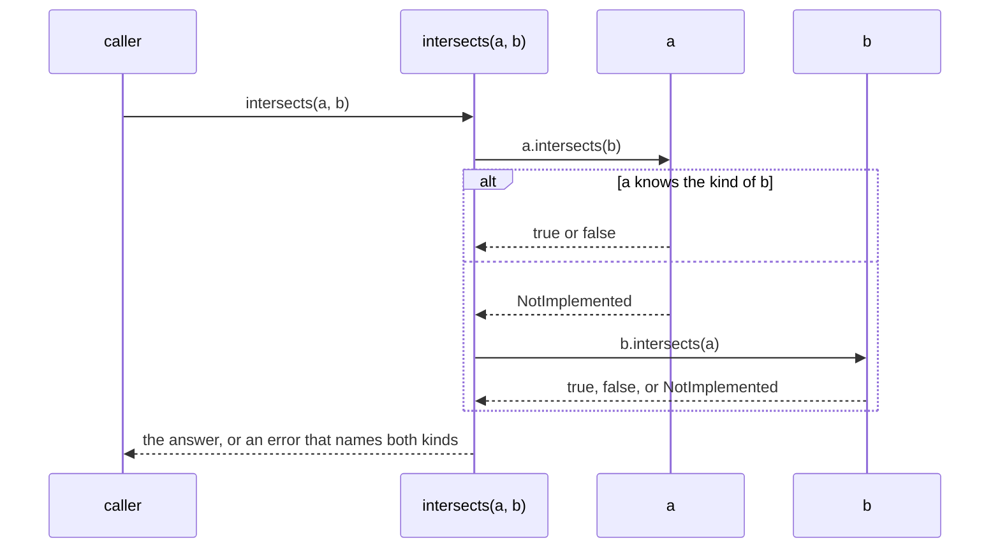

<!--
-*- markdown -*-
-*- coding: utf-8 -*-

michael a.g. aïvázis <michael.aivazis@para-sim.com>
(c) 1998-2026 all rights reserved
-->

# geometry over spaces of known dimension

A design for points, curves, surfaces and the relations among them, over an underlying space of
arbitrary but known dimension. The geometry is C++, in `pyre::geometry`, with `pyre.geometry` as
its Python layer, and `pyre.db` learns to store it in PostGIS.

Branch: `geometry` in `pyre`.

Status: **agreed** on 2026-11-07, nothing built yet.

## The model

A shape is a subset of a **space**. The space, not the shape, decides what a straight edge is, how
distance is measured, and which algorithms apply. Coordinates belong to a **chart** of the space:
the dateline and the poles are properties of the longitude–latitude chart, not of the sphere. A
**reference system** pairs a space with a chart and a datum, and carries the authority code that
PostGIS calls an SRID.

Spaces combine by Cartesian product. A shape in $A \times B$ that is a product of a shape in each
factor intersects another such shape exactly when the factors intersect pairwise, so the support
of a product needs no algorithm of its own.

Time is a one dimensional affine space: instants subtract to give durations, but do not add.

### Spaces

- `Euclidean<d>`: $\mathbb{R}^d$, with straight edges.
- `Sphere`: $S^2$ of a given radius, with great circle edges.
- `Ellipsoid`: an oblate spheroid given by its semi-major axis and flattening, with geodesic
  edges computed by Karney's algorithms, written in pyre.
- `Timeline`: `Euclidean<1>` with an epoch, so that instants and durations are different types.
- `Lattice<d>`: a finite subset of $\mathbb{Z}^d$, the simplest space; a catalog of tracks and
  frames is one.
- `Product<A, B>`: the Cartesian product of two spaces.

### Points

`Point<S>` is an element of the space `S`. The coordinate array of today's `Point<dim, T>` becomes
the storage of `Euclidean` points, and `Brick` and `PointCloud` move onto it. Points on the sphere
and on the ellipsoid are stored as unit vectors in $\mathbb{R}^3$, which have no singularities at
the poles or at the dateline; longitude and latitude exist only through the chart.

A value carried by each vertex, what PostGIS calls the M coordinate, is a field over the vertices
of a shape, not a coordinate of the space.

### Edges

On the sphere and the ellipsoid, a flag on each shape decides how its edges are interpreted:
either as geodesics of the space, or as straight lines in the longitude–latitude chart. Data in
the wild uses both, and the common metadata repository calls them "geodetic" and "cartesian".

## Shapes

Every shape is a template over its space, or, on the curved spaces, over a chart of its space: an
edge that is straight in the chart is only defined by the chart, and the chart knows its space.
The intervals of a line are templates over the line itself. There is no virtual base: shapes
satisfy a `Shape` concept, and `AnyShape` erases the type for heterogeneous collections and for
the bindings, the way `AnyGrid` does for grids. The names are mathematical; the PostGIS names appear only in the
codecs and in `pyre.db`.

The shapes cover everything PostGIS can store:

| PostGIS | `pyre::geometry` | note |
|---|---|---|
| `POINT` | `Point` | |
| `LINESTRING` | `Path` | a chain of segments |
| `LINEARRING` | `Ring` | a closed, simple path |
| `CIRCULARSTRING` | chained `Arc` | |
| `COMPOUNDCURVE` | `Curve` | paths and arcs end to end |
| `POLYGON` | `Polygon` | a boundary ring and rings for its holes |
| `CURVEPOLYGON` | `CurvePolygon` | |
| `TRIANGLE` | `Triangle` | |
| `POLYHEDRALSURFACE` | `Surface` | faces that share edges |
| `TIN` | `Triangulation` | |
| `MULTIPOINT`, `MULTILINESTRING`, `MULTIPOLYGON`, `MULTICURVE`, `MULTISURFACE` | `Collection<T>` | finite unions |
| `GEOMETRYCOLLECTION` | `Collection<AnyShape>` | |
| `BOX2D`, `BOX3D` | `Box` | products of intervals; the envelopes indices work on |
| Z coordinate | a dimension of the space | `Euclidean<3>`, or `Product<Ellipsoid, Euclidean<1>>` for height |
| M coordinate | a field over the vertices | |
| `geometry(T, srid)` | a shape in a planar reference system | |
| `geography(T, srid)` | a shape on `Ellipsoid` or `Sphere` | |
| `tstzrange` and the other ranges | `Interval` | core postgres |

A region in the sense of a search is a `Collection<Polygon>`, so disconnected regions are there
from the start. PostGIS rasters map onto `pyre.grid`, and PostGIS topology, which stores a planar
partition as a cell complex of nodes, edges and faces, comes later.

## Relations

The relations between two shapes are the patterns of their DE-9IM matrix, the dimensions of the
pairwise intersections of their interiors, boundaries and exteriors. `relate(a, b)` computes the
matrix, and the named relations are the patterns PostGIS also offers: `intersects`
($A \cap B \neq \emptyset$), `disjoint`, `contains` and `within`, `covers` and `coveredBy`,
`touches`, `crosses`, `overlaps` and `equals`. `intersects` and `covers` come first.

A relation is a binary operator that delegates to whichever of its operands knows how to compute
it:

The symmetric relations need one method name for both directions, and the knowledge stays with the
shape that has it. In C++ the rule is static: `intersects(a, b)` is an overload set, and a generic
overload, selected by a concept, forwards to `intersects(b, a)` when only that one exists. Products
decompose factor by factor. The Python protocol serves shapes defined in Python.

## Regions on the sphere

The shapes that describe places on the ground, the regions of a search, the footprints of the
frames of a mission, live on the sphere and are written in the `LonLat` chart. Three decisions
shape them, and each one has a reason that is easy to forget; the clients that build regions,
such as qef, repeat the parts that concern them where they build them.

### Longitude first

The coordinates of a point are its longitude and its latitude, in that order: east, then north,
the right-handed order of $x$ and $y$. Everything these shapes exchange data with uses it: WKB,
GeoJSON, PostGIS, geopackages, and the spatial queries of the common metadata repository.
EPSG:4326 officially orders its axes latitude first, and all of those tools ignore it; so does
pyre.

People say north before east, so the python layer never makes them depend on the order: every
entry point that takes a point or a box takes keywords, `longitude` and `latitude`, `west`,
`south`, `east` and `north`. An order shows only where it can't be avoided, in sequences of
vertices, and there it is the order of the chart, whose name says which it is.

### Exact predicates on the sphere

The relations are computed on the sphere, not in the plane of the chart. A point is a unit vector,
a geodesic edge is the shorter arc of the great circle through its ends, and the predicates are
signs of determinants of unit vectors: which side of the great circle through $a$ and $b$ the
point $c$ is on is the sign of $a \cdot (b \times c)$. Two arcs cross when each separates the ends
of the other. Each ring keeps a reference point whose side it knows, and another point is on the
same side as the reference unless the arc between them crosses the ring an odd number of times.

Working on the sphere removes the two places where computing in the chart goes wrong: the
antimeridian, which the sphere doesn't have, and the poles, where the chart is singular and the
sphere isn't. A ring around a pole is an ordinary ring.

A determinant of unit vectors loses its sign when the three are nearly on one great circle. The
predicates compute it in double precision first, and again in twice the precision, with products
split by fused multiply-adds, when the first result is within its error bound of zero.

Whether a point is on an arc is a different question, and exact arithmetic is the wrong tool for
it: a point on a great circle can only be computed to within rounding, so a point placed on an
edge is almost never exactly on it, and the edges of two shapes that share a boundary don't
exactly coincide. A point counts as on an arc when it is within $10^{-12}$ radians of it, about six
microns on the earth. The shapes are closed sets, so a point on a boundary belongs to the shape,
and shapes whose boundaries come that close touch, and intersect. Boxes, which test points by
their coordinates, allow a nanodegree for the same reason.

An edge that is straight in the chart is not a great circle, and where it meets a great circle has
no closed form. Such edges are cut into great-circle arcs no longer than a quarter of a degree,
which stand for them to within a few meters. The relations are therefore exact for geodesic edges
and approximate, within that bound, for edges straight in the chart. The footprints of the frames
of NISAR are drawn with such edges, and so are boxes: a box is the set of points whose longitude
and latitude lie within its bounds, so its edges along the parallels are straight in the chart and
are not great circles.

### The region a ring bounds

A ring on the sphere divides it into two regions, and nothing about the ring alone says which one
it means: a small ring around a city bounds the city, and it also bounds the rest of the earth. In
the plane the bounded side is the obvious choice; on the sphere both sides are bounded.

pyre takes the region to the left of the ring, as one walks along it from vertex to vertex, seen
from outside the sphere. This is the only rule that can describe every region: a region larger
than a hemisphere, such as the earth outside a small area, has a ring like any other, and walking
the same ring the other way describes its complement. A polygon with holes is the intersection of
the regions to the left of its rings, so its outer ring runs counterclockwise around its interior
and its holes run clockwise, the convention of GeoJSON and of the common metadata repository.

The rule is unforgiving: a ring walked the wrong way describes the complement of what was meant,
and a search over the complement of a small region finds nearly everything. Data whose convention
is known is read with it, and reversed when it disagrees. Rings drawn or typed by people come in
either direction, so pyre offers a construction that orients a ring so that it bounds the
smaller of its two regions, the right reading of anything smaller than a hemisphere, which is
anything a person draws on a map. Clients use it for such input, and only for it: it can't
express a region larger than a hemisphere, and it would silently flip one that was meant.

The footprints of the track/frame database of NISAR are a case in point: the outer rings of all
of its 30,448 frames run clockwise in longitude and latitude, the opposite of the rule, so qef
reverses them when it reads them.

## Measures and constructions

Measures depend on the metric of the space: `length`, `area`, `distance`, `centroid`.

Constructions build new shapes: `envelope`, `boundary` and `hull` first, then the set operations
`intersection`, `union` and `difference`. pyre writes all of them itself, the simpler ones first.

## Codecs

WKB and EWKB, WKT and EWKT, readers and writers in C++, and the GeoPackage blob, which is a short
header in front of WKB. GeoJSON lives in the Python layer.

## Layers

- `lib/pyre/geometry`: the spaces, charts, shapes, relations, measures, constructions and codecs.
- `extensions/pyre/geometry`: the bindings, with the shapes instantiated for `Euclidean<2>`,
  `Euclidean<3>`, `Sphere`, `Ellipsoid` and `Timeline`, one instantiation per line.
- `packages/pyre/geometry`: the Python layer, GeoJSON and the reflected protocol. The modules there
  today stay until they get in the way, and are replaced when they do.
- `packages/pyre/db`: the columns, indices and expressions that store the shapes in postgres.

The core library links nothing new. Anything that needs an outside library is a package of its
own; projections such as UTM may come from PROJ, once it is clear what relying on it costs.

## pyre.db

- Columns: `pyre.db.geometry(shape, srid, z, m)`, `pyre.db.geography(shape, srid, z, m)`,
  `pyre.db.box()` and `pyre.db.range(of=...)`, which render as `geometry(POLYGON, 4326)`,
  `tstzrange` and the like.
- Index declarations, with their access method: `btree`, `gist`, `spgist`, `brin`.
- Database extensions, such as `postgis`, declared with the schema.
- Spatial expressions in queries: the relations as `ST_Intersects`, `ST_Covers` and the rest, the
  envelope operator `&&`, and the overlap of ranges.
- Values travel as EWKB in the binary result format, through the C++ codec.

## Tests

Assert drivers, as in the rest of pyre. The `pyre.db` drivers check the SQL they generate without
a server. A suite against a live server, with PostGIS, runs in pyre's own docker containers and in
CI as a GitHub service container on a Linux runner; it comes at the end of the work.

<!-- end of file -->
